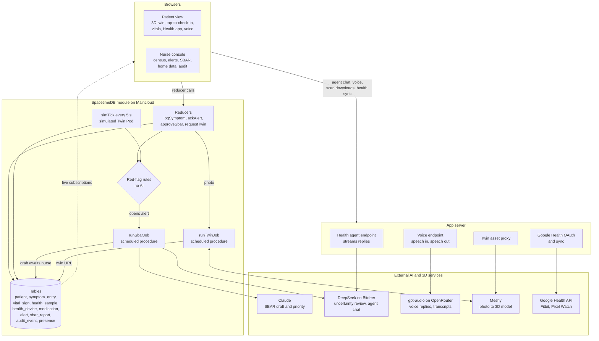

# Digital Twin Biomedical

**A live 3D twin of every patient recovering at home, shared in real time between the patient and their nurse.**

Patients point to where it hurts on their own body instead of filling out forms. A simulated wearable streams their vitals, and their Apple Watch, Fitbit, scale and blood pressure cuff feed the same record. They can ask their health agent questions by typing or out loud. Fixed safety rules watch every reading, AI drafts the clinical handoff, and the nurse sees it all on the same twin, at the same moment, with nothing sent to a doctor until a human approves it.

Built at Cal Hacks 13.0.

---

## The problem

Care breaks down between visits. Patients now go home a day after a knee replacement and manage heart failure, COPD, diabetic wounds and spinal cord injuries from their living rooms. That's also where complications start: a blood clot in the calf, an infected incision, fluid building up in the lungs.

- **Patients struggle to describe what they feel.** "It hurts around here" over the phone is hard to triage, and patients often can't tell "normal" from "call someone now."
- **Nurses translate vague reports by hand.** A follow-up nurse with 25 patients has to turn each phone call into a structured assessment (OPQRST) and a handoff to the physician (SBAR).
- **Warning signs arrive between appointments.** By the next visit, a symptom has either gone away or become an emergency.

## What it does

### For the patient
- **Their own body, in 3D.** Upload a full-body photo and the twin is generated to look like them. Switch to **Anatomy** to see muscles, bones and blood vessels, or focus on the area their condition affects: the knee, head, heart, lungs, foot or spine.
- **Tap where it hurts.** A tap drops a pin on the exact body region ("Right calf (back)") and opens a short check-in with large chips and a pain slider instead of free text.
- **Live vitals from the Twin Pod.** Heart rate, blood pressure, respiratory rate, SpO₂ and temperature stream onto the dashboard and onto the twin itself.
- **Their health record, Apple Health style.** A Health app inside the twin has activity rings (Move, Exercise, and Stand, or Roll for wheelchair users), pinned metrics and highlights. It also covers every Apple Health category: activity, body measurements, heart, respiratory, vitals, sleep stages, mobility, nutrition, mindfulness, cycle tracking and symptoms. Each metric has day, week, month and six-month charts. Patients can log blood pressure, weight, glucose, mood, a period or a workout, and tick off each medication dose.
- **Their own devices.** Patients can import an Apple Health export (`export.zip` from the iPhone Health app). It's read in the browser, covering Apple Watch, iPhone, scale, cuff and glucose monitor data, and only daily or hourly summaries are uploaded. Fitbit and Pixel Watch connect through the Google Health API. Labelled demo devices can be paired for the hackathon demo.
- **A health agent that knows them.** Patients can ask "How am I doing today?" or "What does this number mean?" and get answers grounded in their own twin and readings. It doesn't diagnose, and it points to 911 for red flags.
- **Or just talk to it.** Tap the mic and speak. There's no button to hold: the agent notices when you pause, starts answering out loud about two seconds later, and stops if you talk over it. Both sides of the conversation are written into the chat. This helps patients who are post-op, iced and elevated, or have their hands full.
- **Clear status, never raw AI output.** Patients see "Your care team has been notified," then "Marcus has reviewed your check-in." Chest pain or sudden shortness of breath shows **Call 911 now** instantly.

### For the nurse
- **A census sorted by who needs attention.** Every patient, their condition, live heart rate and alert priority on one strip.
- **The same live twin, with pins.** Check-ins appear on the nurse's twin the instant the patient sends them, next to the patient's own words. The nurse's pointer also shows up on the patient's twin, so they can talk about the same spot.
- **Home and wearable data next to the pod.** A tab beside the Twin Pod vitals shows the condition-specific trends a nurse watches: daily weight and sodium for heart failure, glucose for diabetic wounds, SpO₂ and respiratory rate for COPD, and steps or pushes for mobility. It also shows missed medication doses and wearable flags. The patient's full health record is one click away.
- **An SBAR handoff already drafted.** When a rule fires, the AI drafts the Situation, Background, Assessment and Recommendation. A second model lists what that draft is uncertain about and what to ask the patient. The nurse edits, approves, escalates or resolves it.
- **A clinical agent, by text or voice.** It sees the census and the open chart, and helps prioritize patients, interpret trends, tighten SBAR wording and suggest questions to ask.
- **A full audit trail.** Every check-in, rule, AI draft and nurse action is timestamped and read-only.

## Safety by design

AI helps the nurse, but it never makes the call.

1. **Fixed rules run first, without any AI.** They check for possible pulmonary embolism, blood clot, infection, uncontrolled pain, low SpO₂, tachycardia, fever, tachypnea and abnormal blood pressure. Home and wearable readings get their own rules: a heart-failure weight gain of 2 lb in a day or 5 lb in a week, resting heart rate 10+ bpm above the past week, watch SpO₂ below 90%, an irregular rhythm notification, and glucose below 70 or above 300 mg/dL. Each rule sets a *priority floor*.
2. **AI can only raise priority.** It can never lower a rule's priority and never sets "emergency"; emergencies are fixed rules with a 911 prompt.
3. **Every AI draft needs a nurse's approval.** Drafts are labeled "needs approval," and edits are recorded.
4. **A second model checks the first.** An independent DeepSeek review lists the draft's uncertainties: missing data, conflicting signals, simulated sensor data. It sees the draft with the patient's name removed.
5. **Patients never see triage output.** They see only status updates and what their nurse approves.
6. **Least-privilege context.** The patient's agent, typed or spoken, sees only that patient's record. API keys and OAuth tokens stay on the server and never reach a browser.
7. **Voice follows the same rules.** The voice agent gets the text agent's safety prompt unchanged, plus rules for speaking aloud, so an emergency instruction is still the first thing it says.

## Architecture



**SpacetimeDB is the whole backend.** It holds every table, runs the reducers, and pushes changes to subscribed clients. That's why a patient's tap shows up on the nurse's screen with no polling and no separate API server. Alert rules run inside the same transaction that writes the check-in or vital sign, so a red flag can't be missed between services.

**Network calls happen only in scheduled procedures.** When a rule opens an alert, `runSbarJob` builds a structured, name-free record of rule results, recent check-ins and vitals statistics. It asks Claude for an SBAR draft through a strict tool schema, asks DeepSeek to review it, and writes the result back for nurse approval. If a model is unavailable, a template draft is used, so the nurse is never blocked. `runTwinJob` submits the patient's photo to Meshy, polls until the textured model is ready, and saves the result on the patient. Neither job ever automatically resubmits a billable request.

**The 3D twin** uses React Three Fiber. Photo scans are normalized to a standard height, so tap-to-region mapping, hotspots and pins work on any body, standing or seated in a wheelchair. The Anatomy view is a meshopt-compressed model derived from BodyParts3D (skin, muscle, bone, arteries and veins). A knee implant is shown only for patients who have one.

**The health agents** stream from a small server endpoint that holds the key. The patient and nurse agents use separate system prompts. The nurse agent sees the census and the open chart; the patient agent sees only the patient's own twin and readings. Both agents, and the SBAR job, get a seven-day digest of home and wearable data: daily values, missed doses and irregular rhythm notifications.

**Voice chat** uses OpenAI's gpt-audio through OpenRouter. The browser listens with an energy-based turn detector that adapts to background noise. When you pause, it sends that turn as a 16 kHz WAV. The server streams the spoken reply back as 24 kHz PCM, and the browser starts playing it as soon as the first chunk arrives. A parallel text-only pass transcribes what you said, so the chat shows both sides and later turns, spoken or typed, keep the context. Talking over the agent interrupts it. The voice agent uses the same safety prompt and record context as the text agent, plus rules for speaking aloud.

**Health integrations.** There is no HealthKit on the web, so Apple Health data arrives as the export from the iPhone Health app. The browser streams the zip with fflate, parses `export.xml` in chunks, and rolls readings up per source: daily totals, hourly heart rate and blood pressure, and sleep stages per night. It converts units (lb, °F, mmol/L, miles) and uploads at most 4,000 summaries per batch. Re-importing updates readings it already has instead of duplicating them. Fitbit and Pixel Watch data comes from the Google Health API, because the older Fitbit Web API is being retired. The OAuth client secret and refresh tokens stay in the app server, which returns only normalized readings to the browser.

## Built with

| Layer | Technology |
|---|---|
| Real-time backend | SpacetimeDB 2.13 (TypeScript module, Maincloud) |
| Frontend | React, Vite, TypeScript |
| 3D | three.js, React Three Fiber, drei, BodyParts3D anatomy |
| SBAR drafting | Anthropic Claude (tool use) |
| Draft review and health agents | DeepSeek V4.1 Flash on Bitdeer |
| Voice chat | OpenAI gpt-audio via OpenRouter |
| Photo to 3D | Meshy image-to-3D |
| Health integrations | Apple Health export (parsed in the browser with fflate), Google Health API for Fitbit and Pixel Watch |
| Development | Cursor |

## Measuring impact

The nurse console computes its metrics live from the database: open alerts, median time from alert to acknowledgment, and how many patients checked in during the last 24 hours. Every SBAR stores the AI's original draft alongside the approved version, so nurse edit rates can be measured.

A pilot would follow about 20 patients at one orthopedic practice for six weeks, compared with that practice's current phone follow-up. It would measure:
- days from the first warning sign to nurse contact
- unplanned ER visits and readmissions
- nurse minutes per patient per week
- patient satisfaction

## What's next

- **Real sensors.** The Twin Pod is designed (an nRF52840 with an IMU, a skin temperature sensor and a PPG sensor, worn as a knee patch or bracelet) but simulated today.
- **Native HealthKit and Health Connect sync** through a companion iOS and Android app, so data arrives continuously instead of from an export.
- **Voice check-ins.** Let the voice agent log a symptom on the twin ("my left calf is tight and warm") as a check-in the nurse can act on, not just answer questions.
- **Streaming voice** over a realtime connection, so replies can start while the patient is still finishing a sentence.
- **Validated thresholds** reviewed by clinicians, and a triage evaluation set labeled by nurses.
- **EHR integration** so approved SBARs go straight into the chart.

## Team

Isak Smith and Kadrian Ayarza.

---

## Running it locally

Requires Node 22+ and the [SpacetimeDB CLI](https://spacetimedb.com/install) 2.13+.

```bash
spacetime start --listen-addr 127.0.0.1:3100
spacetime server add twinlocal --url http://127.0.0.1:3100 --no-fingerprint   # once
npm install && (cd spacetimedb && npm install)
spacetime publish twincare --server twinlocal --module-path spacetimedb --yes   # seeds 6 demo patients
npm run dev
```

Open `/?role=patient` and `/?role=nurse` in two windows. In the nurse console, **Controls** switch a patient's simulated pod to a blood clot, infection or fluid overload pattern. **Reset data** there restores the example check-ins and regenerates each patient's four weeks of home and wearable history, ending at the current time. Run it before a demo so the data is current.

The app works without any API keys: SBARs fall back to a template, the twin uses the anatomy view, the text agent replies that it isn't set up yet, the mic button stays hidden, and Sources offers demo devices. Each key turns on one feature. Keys are never `VITE_*` variables, so they stay out of the browser bundle.

| Variable | Where | Turns on |
|---|---|---|
| `ANTHROPIC_API_KEY`, `BITDEER_API_KEY` | shell, when publishing the module | AI SBAR drafts and their review |
| `MESHY_API_KEY` | shell, when publishing the module | Photo-to-3D twins |
| `BITDEER_API_KEY` | `.env.local` | Text chat with the health agents |
| `OPENROUTER_API_KEY` | `.env.local` | Voice chat (optional `OPENROUTER_VOICE`, default `coral`) |
| `GOOGLE_HEALTH_CLIENT_ID`, `GOOGLE_HEALTH_CLIENT_SECRET`, `GOOGLE_HEALTH_REDIRECT_URI` | `.env.local` | Fitbit and Pixel Watch sync |

For Google Health, create an OAuth client in Google Cloud with the Google Health API enabled, and use a redirect URI like `http://localhost:5173/api/health/google/callback`. To try an Apple Health import, open Health, go to Sources, and choose the `export.zip` from the iPhone Health app (profile picture, then Export All Health Data).

The agent, voice, Google Health and twin-download routes run inside the Vite server, so use `npm run dev` or `npm run preview`. A static deployment would need them as edge functions.

Run `npm test` and `npm run build` for checks; the tests mock every external API.

## Credits and disclaimer

The anatomy model (`public/models/anatomy.glb`) is derived from BodyParts3D, © The Database Center for Life Science, licensed under [CC Attribution-Share Alike 2.1 Japan](http://dbarchive.biosciencedbc.jp/en/bodyparts3d/lic.html). The derived GLB carries the same license. Rebuild it with `npm run build:anatomy` after downloading the BodyParts3D archive into `~/.cache/bp3d`.

Prototype with fictional patients and simulated vitals. Not a medical device, and it does not replace calling your care team.
