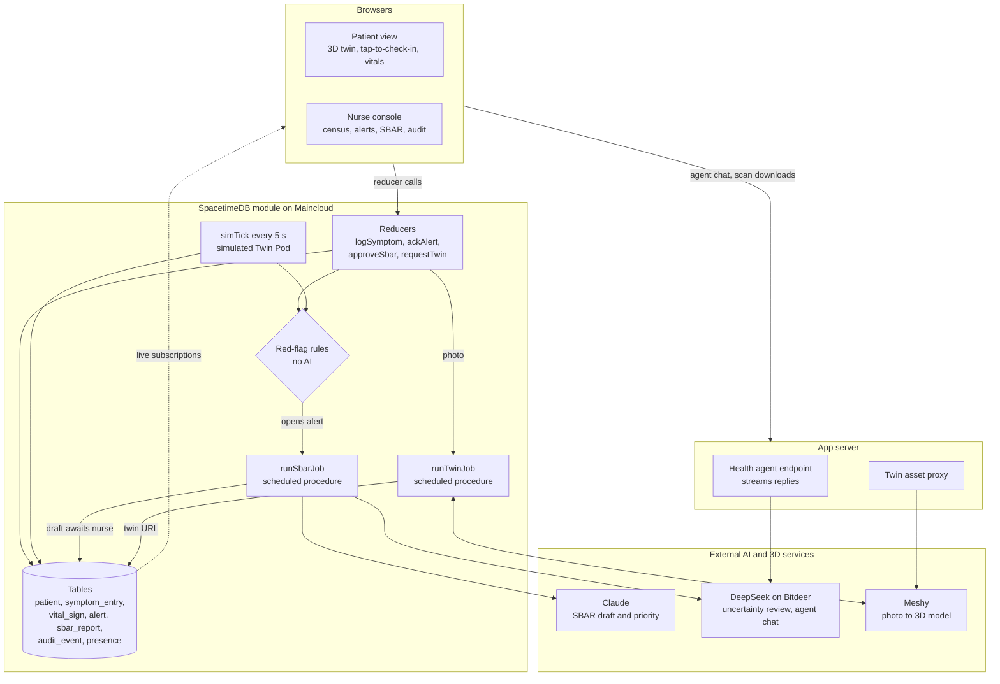

# Digital Twin Biomedical

**A live 3D twin of every patient recovering at home, shared in real time between the patient and their nurse.**

Patients point to where it hurts on their own body instead of filling out forms. A simulated wearable streams their vitals. Fixed safety rules watch every reading, AI drafts the clinical handoff, and the nurse sees it all on the same twin, at the same moment, with nothing sent to a doctor until a human approves it.

Built at Cal Hacks 13.0.

---

## The problem

Care breaks down between visits. Patients now go home a day after a knee replacement and manage heart failure, COPD, diabetic wounds and spinal cord injuries from their living rooms. That's also where complications start: a blood clot in the calf, an infected incision, fluid building up in the lungs.

- **Patients struggle to describe what they feel.** "It hurts around here" over the phone is hard to triage, and patients often can't tell "normal" from "call someone now."
- **Nurses translate vague reports by hand.** A follow-up nurse with 25 patients has to turn each phone call into a structured assessment (OPQRST) and a handoff to the physician (SBAR).
- **Warning signs arrive between appointments.** By the next visit, a symptom has either gone away or become an emergency.

## What it does

### For the patient
- **Their own body, in 3D.** Upload a full-body photo and the twin is generated to look like them. Switch to **Anatomy** to see muscles, bones and blood vessels, or focus on the area their condition affects: the knee, head, heart, lungs, foot or spine.
- **Tap where it hurts.** A tap drops a pin on the exact body region ("Right calf (back)") and opens a short check-in with large chips and a pain slider instead of free text.
- **Live vitals from the Twin Pod.** Heart rate, blood pressure, respiratory rate, SpO₂ and temperature stream onto the dashboard and onto the twin itself.
- **A health agent that knows them.** Patients can ask "How am I doing today?" or "What does this number mean?" and get answers grounded in their own twin and readings. It doesn't diagnose, and it points to 911 for red flags.
- **Clear status, never raw AI output.** Patients see "Your care team has been notified," then "Marcus has reviewed your check-in." Chest pain or sudden shortness of breath shows **Call 911 now** instantly.

### For the nurse
- **A census sorted by who needs attention.** Every patient, their condition, live heart rate and alert priority on one strip.
- **The same live twin, with pins.** Check-ins appear on the nurse's twin the instant the patient sends them, next to the patient's own words. The nurse's pointer also shows up on the patient's twin, so they can talk about the same spot.
- **An SBAR handoff already drafted.** When a rule fires, the AI drafts the Situation, Background, Assessment and Recommendation. A second model lists what that draft is uncertain about and what to ask the patient. The nurse edits, approves, escalates or resolves it.
- **A full audit trail.** Every check-in, rule, AI draft and nurse action is timestamped and read-only.

## Safety by design

AI helps the nurse, but it never makes the call.

1. **Fixed rules run first, without any AI.** They check for possible pulmonary embolism, blood clot, infection, uncontrolled pain, low SpO₂, tachycardia, fever, tachypnea and abnormal blood pressure. Each rule sets a *priority floor*.
2. **AI can only raise priority.** It can never lower a rule's priority and never sets "emergency"; emergencies are fixed rules with a 911 prompt.
3. **Every AI draft needs a nurse's approval.** Drafts are labeled "needs approval," and edits are recorded.
4. **A second model checks the first.** An independent DeepSeek review lists the draft's uncertainties: missing data, conflicting signals, simulated sensor data. It sees the draft with the patient's name removed.
5. **Patients never see triage output.** They see only status updates and what their nurse approves.
6. **Least-privilege context.** The patient's agent sees only that patient's record. API keys stay on the server and never reach a browser.

## Architecture



**SpacetimeDB is the whole backend.** It holds every table, runs the reducers, and pushes changes to subscribed clients. That's why a patient's tap shows up on the nurse's screen with no polling and no separate API server. Alert rules run inside the same transaction that writes the check-in or vital sign, so a red flag can't be missed between services.

**Network calls happen only in scheduled procedures.** When a rule opens an alert, `runSbarJob` builds a structured, name-free record of rule results, recent check-ins and vitals statistics. It asks Claude for an SBAR draft through a strict tool schema, asks DeepSeek to review it, and writes the result back for nurse approval. If a model is unavailable, a template draft is used, so the nurse is never blocked. `runTwinJob` submits the patient's photo to Meshy, polls until the textured model is ready, and saves the result on the patient. Neither job ever automatically resubmits a billable request.

**The 3D twin** uses React Three Fiber. Photo scans are normalized to a standard height, so tap-to-region mapping, hotspots and pins work on any body, standing or seated in a wheelchair. The Anatomy view is a meshopt-compressed model derived from BodyParts3D (skin, muscle, bone, arteries and veins). A knee implant is shown only for patients who have one.

**The health agents** stream from a small server endpoint that holds the key. The patient and nurse agents use separate system prompts. The nurse agent sees the census and the open chart; the patient agent sees only the patient's own twin and readings.

## Built with

| Layer | Technology |
|---|---|
| Real-time backend | SpacetimeDB 2.13 (TypeScript module, Maincloud) |
| Frontend | React, Vite, TypeScript |
| 3D | three.js, React Three Fiber, drei, BodyParts3D anatomy |
| SBAR drafting | Anthropic Claude (tool use) |
| Draft review and health agents | DeepSeek V4.1 Flash on Bitdeer |
| Photo to 3D | Meshy image-to-3D |
| Development | Cursor |

## Measuring impact

The nurse console computes its metrics live from the database: open alerts, median time from alert to acknowledgment, and how many patients checked in during the last 24 hours. Every SBAR stores the AI's original draft alongside the approved version, so nurse edit rates can be measured.

A pilot would follow about 20 patients at one orthopedic practice for six weeks, compared with that practice's current phone follow-up. It would measure:
- days from the first warning sign to nurse contact
- unplanned ER visits and readmissions
- nurse minutes per patient per week
- patient satisfaction

## What's next

- **Real sensors.** The Twin Pod is designed (an nRF52840 with an IMU, a skin temperature sensor and a PPG sensor, worn as a knee patch or bracelet) but simulated today.
- **Voice check-ins** for patients who can't easily tap: post-op, iced, elevated.
- **Validated thresholds** reviewed by clinicians, and a triage evaluation set labeled by nurses.
- **EHR integration** so approved SBARs go straight into the chart.

## Team

Isak Smith and Kadrian Ayarza.

---

## Running it locally

Requires Node 22+ and the [SpacetimeDB CLI](https://spacetimedb.com/install) 2.13+.

```bash
spacetime start --listen-addr 127.0.0.1:3100
spacetime server add twinlocal --url http://127.0.0.1:3100 --no-fingerprint   # once
npm install && (cd spacetimedb && npm install)
spacetime publish twincare --server twinlocal --module-path spacetimedb --yes   # seeds 6 demo patients
npm run dev
```

Open `/?role=patient` and `/?role=nurse` in two windows. In the nurse console, **Demo controls** switch a patient's simulated pod to a blood clot, infection or fluid overload pattern. The app works without any API keys: SBARs fall back to a template, and the twin uses the anatomy view. For AI drafts and photo twins, pass `ANTHROPIC_API_KEY`, `BITDEER_API_KEY` and `MESHY_API_KEY` as shell variables when publishing (never as `VITE_*` variables). The health agents read `BITDEER_API_KEY` from `.env.local`. Run `npm test` and `npm run build` for checks; the tests mock every external API.

## Credits and disclaimer

The anatomy model (`public/models/anatomy.glb`) is derived from BodyParts3D, © The Database Center for Life Science, licensed under [CC Attribution-Share Alike 2.1 Japan](http://dbarchive.biosciencedbc.jp/en/bodyparts3d/lic.html). The derived GLB carries the same license. Rebuild it with `npm run build:anatomy` after downloading the BodyParts3D archive into `~/.cache/bp3d`.

Prototype with fictional patients and simulated vitals. Not a medical device, and it does not replace calling your care team.
